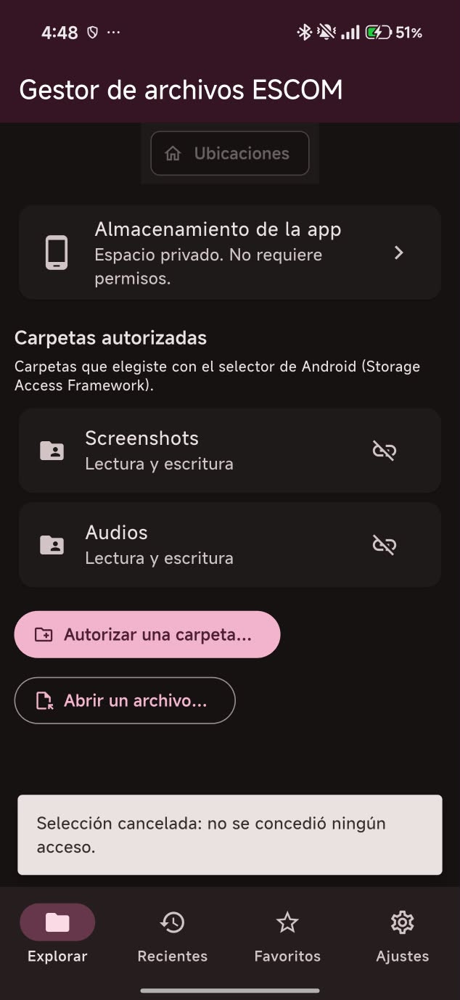
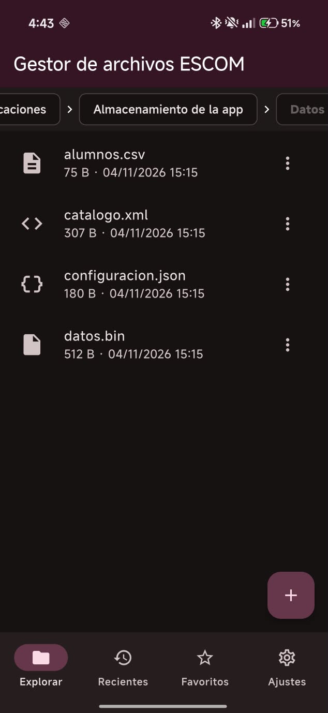
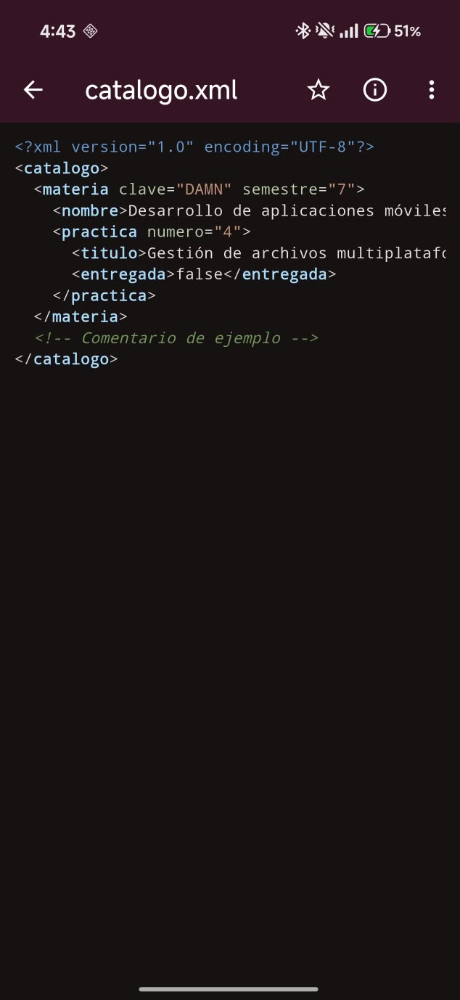
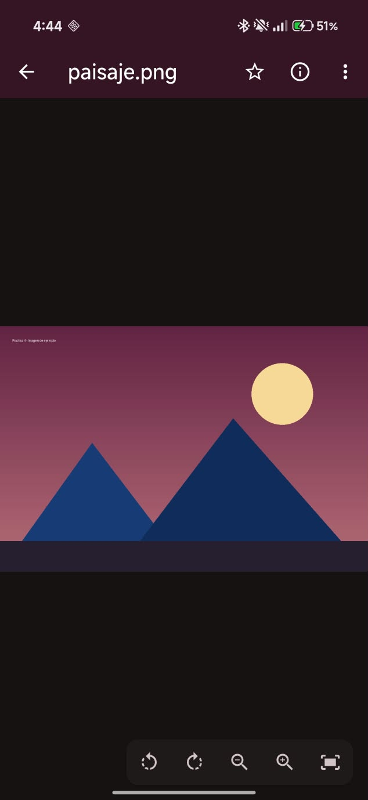
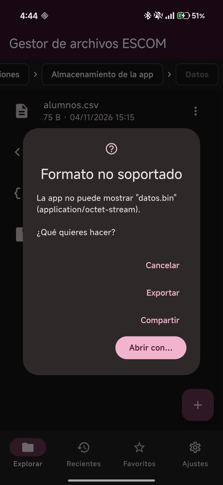
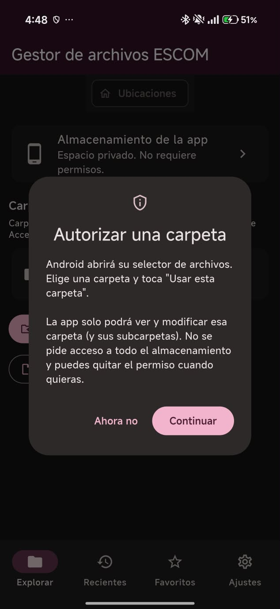
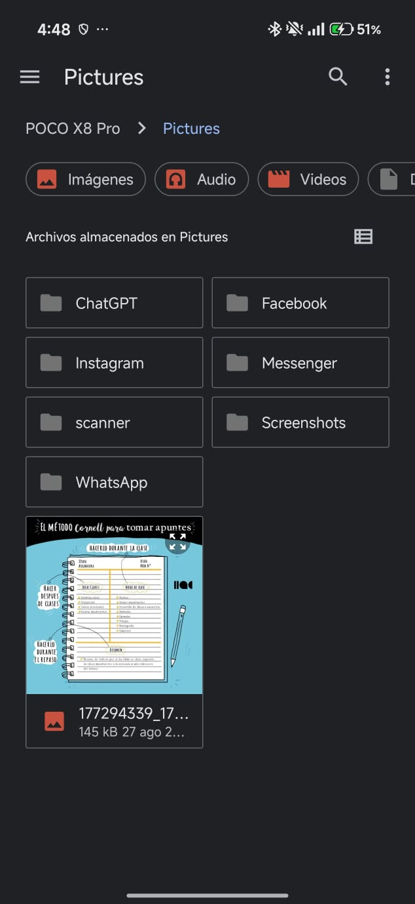
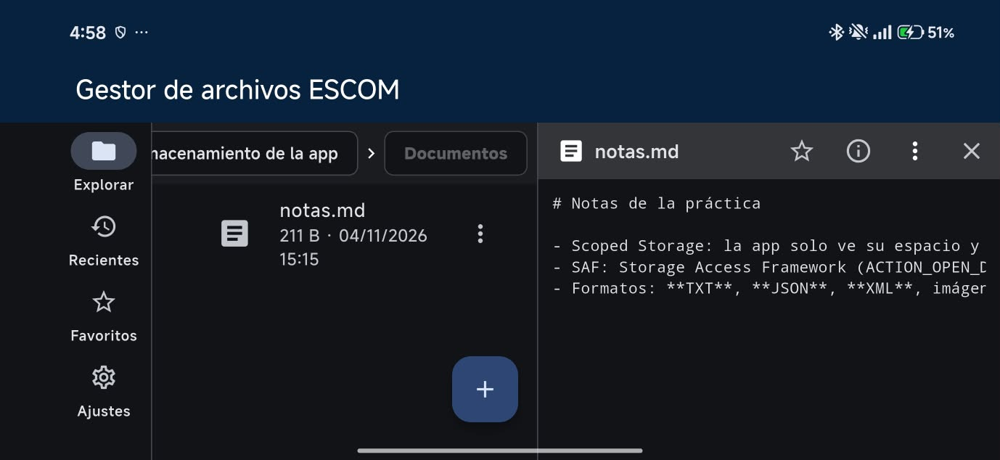

# Gestor de archivos ESCOM

**Práctica 4 · Parte 1: Gestor de archivos multiplataforma**
Desarrollo de aplicaciones móviles nativas · ESCOM IPN · Grupo 7CV4

Esta app explora y administra los documentos y carpetas a los que tiene **acceso legítimo**:
- Su propio almacenamiento privado;
- Las carpetas o archivos que el usuario autoriza con el selector del sistema.

No pide acceso global al almacenamiento y funciona **100 % sin conexión**.

> Las versiones del entorno, los pasos completos de instalación y la parte de iOS están en el [README principal](../README.md).

---

## Funcionalidades

### Exploración
- **Ubicaciones** (pantalla inicial):
  - **Almacenamiento de la app**: Espacio privado, no requiere permisos.
  - **Carpetas autorizadas**: Se eligen con el selector de Android (Storage Access Framework). El permiso persiste aunque se cierre la app, se indica si es de lectura y escritura o solo lectura, y se puede **quitar el acceso** en cualquier momento.
  - **Abrir un archivo…**: Abre un documento suelto con el selector del sistema.
- **Breadcrumbs** (`Ubicaciones › Datos › …`): Cada parte se puede tocar para regresar. También hay botón *Atrás* y el gesto de regreso de Android.
- Se ordenan carpetas primero y luego archivos, en orden alfabético. La lista se actualiza deslizando hacia abajo.
- La primera vez se crean **archivos de ejemplo** de cada formato: `.txt`, `.md`, `.json`, `.xml`, `.csv`, `.png` y `.bin`.

### Visualización
| Tipo | Extensiones | Visor |
|---|---|---|
| Texto | `.txt`, `.md`, `.csv`, `.log`, `.yaml`, `.ini`, `.dart`, `.kt`, `.java`, `.py`, `.html`, `.css`… | Texto seleccionable en fuente monoespaciada |
| JSON | `.json` | Se formatea con sangría y se colorean claves, cadenas, números y `true/false/null`. Si el JSON es inválido, se avisa y se muestra el original. |
| XML | `.xml`, `.svg`, `.plist` | Se formatea con sangría y se colorean etiquetas, atributos, valores y comentarios. Si el XML es inválido, se avisa. |
| Imagen | `.png`, `.jpg`, `.jpeg`, `.gif`, `.webp`, `.bmp` | **Zoom** con pellizco o botones (0.5x a 8x), **rotación** de 90° y doble toque para restablecer |
| Otros | `.bin`, `.pdf`, `.zip`, audio, video… | Diálogo con **Abrir con…**, **Compartir** o **Exportar copia** usando las apps del sistema |

- En archivos de más de 2 MB se muestran los primeros 2 MB con un aviso, para no congelar la app.
- El resaltado de sintaxis está hecho con expresiones regulares propias, sin librerías externas.

### Metadatos
Para ver los detalles de un archivo, mantenlo presionado o usa el botón ⓘ.
- **Nombre**
- **Tipo MIME** (o "No disponible" si no se reconoce)
- **Tamaño**
- **Fecha de modificación**
- **Fecha de creación**: Android no expone este dato, así que se muestra *"No disponible (Android no expone este dato)"*, como pide la práctica.
- **Origen** y ruta o URI
- Para documentos autorizados, **qué permite el proveedor**: escritura, renombrar y eliminar.

### Operaciones con archivos
| Operación | Almacenamiento de la app | Carpetas autorizadas (SAF) |
|---|---|---|
| Copiar | Archivos y carpetas (recursivo) | Archivos |
| Mover | Archivos y carpetas | Archivos (nativo o copiar + eliminar) |
| Renombrar | ✓ | Si el proveedor lo permite |
| Eliminar | ✓ (pide confirmación) | Si el proveedor lo permite (pide confirmación) |
| Nueva carpeta / nuevo archivo de texto | ✓ | Si la carpeta admite escritura |
| Importar a la app | — | Copia el documento al almacenamiento privado |
| Exportar copia… | El usuario elige el destino con el selector | ✓ |
| Compartir | ✓ | ✓ |

Antes de escribir, la app valida:
- Que el nombre no esté vacío ni use `/ \ : * ? " < > |`;
- Que no exista otro elemento con el mismo nombre (si existe, la copia se llama `nombre (1)`);
- Que no se copie ni mueva una carpeta dentro de sí misma;
- Que el proveedor permita la operación;
- Que haya **espacio libre suficiente**.

Las opciones que el proveedor no permite aparecen como *"(no permitido)"*; al tocarlas se explica por qué.

### Persistencia y rendimiento
- **Recientes**: Los últimos 20 archivos abiertos. Se borran deslizando o con *Limpiar*.
- **Favoritos**: Archivos y carpetas. Una carpeta favorita abre directo en el explorador.
- Los dos se guardan con `shared_preferences`, así que siguen ahí al cerrar la app.
- **Caché de miniaturas** LRU:
  - hasta 150 miniaturas, decodificadas a 160 px con `ResizeImage` en lugar de la imagen completa;
  - se invalida cuando el archivo cambia, porque la clave incluye la fecha de modificación.
- Los documentos SAF se copian a una **caché temporal** para leerlos. Su tamaño se ve en *Ajustes → Caché*, donde también se puede limpiar.

### Interfaz
- **Tema Guinda (IPN, `#6C1D45`)** y **Tema Azul (ESCOM, `#003D79`)**: se eligen en *Ajustes* y la elección persiste.
- **Modo claro/oscuro automático**, según el sistema (`ThemeMode.system`).
- **Diseño responsivo:**
  - Teléfono vertical: barra de navegación inferior, y el visor se abre a pantalla completa.
  - Pantalla ancha (840 dp o más, tableta u horizontal): barra lateral (`NavigationRail`), y el visor aparece en un **panel a la derecha** del explorador.

### Manejo de errores
Ningún error de archivos cierra la app. Cada situación muestra un mensaje en español:

| Situación | Mensaje |
|---|---|
| Permiso revocado | "Permiso denegado o revocado. Vuelve a autorizar la carpeta…" |
| Archivo movido o eliminado | "El archivo ya no existe…", con la opción de quitarlo de recientes o favoritos |
| Selector cancelado | "Selección cancelada: no se concedió ningún acceso." |
| Operación no soportada por el proveedor | "Operación no permitida: …" |
| Sin espacio | "Almacenamiento insuficiente: se necesitan X y solo hay Y libres." |
| Carpeta autorizada que ya no existe | Aparece como **No disponible** en Ubicaciones |

---

## Cómo se cumple cada requisito

| Requisito de la práctica | Dónde |
|---|---|
| Explorar el espacio propio y carpetas o documentos elegidos con el selector | `ui/explorador.dart` → `_ubicaciones()`, `_autorizarCarpeta()`, `_abrirArchivoSuelto()` |
| Estructura de carpetas autorizadas, sin acceso irrestricto | `data/archivos.dart` → `listar()`; `MainActivity.kt` → `listar()` |
| Abrir texto (.txt, .md…) | `ui/visor.dart` → `ContenidoArchivo` |
| JSON y XML con resaltado | `ui/resaltado.dart` → `CodigoResaltado` |
| Imágenes con zoom y rotación | `ui/visor.dart` → `VisorImagen` |
| Formatos no soportados: abrir, compartir o exportar | `ui/acciones.dart` → `dialogoNoSoportado()` |
| Metadatos, indicando los no disponibles | `ui/acciones.dart` → `mostrarDetalles()` |
| Temas Guinda y Azul + claro/oscuro | `core/tema.dart`, `ui/ajustes.dart`, `main.dart` |
| Interfaz responsiva | `ui/pantalla_inicio.dart` (`LayoutBuilder`, umbral de 840 dp) |
| Breadcrumbs | `ui/explorador.dart` → `_breadcrumbs()` |
| Recientes persistentes | `data/preferencias.dart`, `ui/listas.dart` → `ListaRecientes` |
| Favoritos persistentes | `data/preferencias.dart`, `ui/listas.dart` → `ListaFavoritos` |
| Caché de miniaturas | `ui/miniaturas.dart` → `CacheMiniaturas` |
| Copiar, mover, renombrar y eliminar | `data/archivos.dart`; `MainActivity.kt` (SAF) |
| Pedir acceso solo cuando hace falta, explicar su finalidad y respetar la cancelación | `ui/explorador.dart` → `_explicar()` |
| Rutas no disponibles, permisos revocados, lectura fallida, falta de espacio | `core/errores.dart` → `mensajeError()`; `data/archivos.dart` → `_verificarEspacio()` |
| Scoped Storage + SAF | `android/.../MainActivity.kt` (sin permisos de almacenamiento en el manifiesto) |
| Validar antes de escribir y confirmar acciones destructivas | `data/archivos.dart` → `validarNombre()`, `_validarDestino()`; `ui/acciones.dart` → `confirmar()` |

---

## Arquitectura

```
lib/
├── main.dart                 Inicializa preferencias y almacenamiento; MaterialApp con temas
├── core/
│   ├── tema.dart             Paletas Guinda y Azul, ThemeData claro y oscuro
│   ├── errores.dart          ErrorApp y mensajeError(): excepciones → mensajes en español
│   └── formato.dart          Tamaños (KB/MB) y fechas legibles
├── data/
│   ├── entrada.dart          Modelo Entrada: archivo o carpeta, de origen local o SAF
│   ├── archivos.dart         Operaciones: listar, leer, copiar, mover, renombrar, eliminar, crear, importar
│   ├── preferencias.dart     Tema, recientes y favoritos (shared_preferences + ChangeNotifier)
│   └── tipos.dart            Detección del tipo de visor e íconos
├── platform/
│   └── saf_android.dart      Puente MethodChannel "mx.ipn.escom/saf" hacia Kotlin
└── ui/
    ├── pantalla_inicio.dart  Navegación responsiva (NavigationBar / NavigationRail + panel)
    ├── explorador.dart       Ubicaciones, breadcrumbs, lista y acciones
    ├── visor.dart            Visor de texto, JSON, XML e imagen
    ├── resaltado.dart        Resaltado de sintaxis JSON/XML
    ├── selector_destino.dart Diálogo para elegir la carpeta destino al copiar o mover
    ├── listas.dart           Recientes y favoritos
    ├── acciones.dart         Detalles, compartir, abrir con, exportar, diálogos y progreso
    ├── miniaturas.dart       Caché LRU de miniaturas
    └── ajustes.dart          Tema, caché, ejemplos y "Acerca de"

android/app/src/main/kotlin/mx/ipn/escom/gestor_archivos/MainActivity.kt
```

**Flujo de una operación.** La UI llama a `Archivos`. Si la entrada es de **origen local**, se usa `dart:io`. Si es de **origen SAF**, se llama a `SafAndroid`, que usa el `MethodChannel` para llegar a `MainActivity.kt`, y este a `DocumentsContract` / `ContentResolver`.

Si algo falla, el error regresa como `PlatformException` o `FileSystemException`, `mensajeError()` lo convierte en un texto en español y se muestra en un `SnackBar`.

### Código específico de Android (`MainActivity.kt`)

| Método del canal | API de Android |
|---|---|
| `elegirCarpeta` | `ACTION_OPEN_DOCUMENT_TREE` + `takePersistableUriPermission` |
| `elegirArchivo` | `ACTION_OPEN_DOCUMENT` |
| `exportar` | `ACTION_CREATE_DOCUMENT` + `openOutputStream` |
| `carpetasAutorizadas` / `quitarAcceso` | `persistedUriPermissions` / `releasePersistableUriPermission` |
| `listar` / `info` | `buildChildDocumentsUriUsingTree` + `ContentResolver.query` |
| `copiarACache` | `openInputStream` → `cacheDir/saf` |
| `renombrar` / `eliminar` | `DocumentsContract.renameDocument` / `deleteDocument` |
| `copiar` | `createDocument` + copia por *streams* |
| `mover` | `moveDocument`; si el proveedor no lo soporta, copia y elimina |
| `crearCarpeta` / `crearArchivo` | `createDocument` con `MIME_TYPE_DIR` o `text/plain` |
| `abrirCon` / `compartir` | `ACTION_VIEW` / `ACTION_SEND` con `FLAG_GRANT_READ_URI_PERMISSION` |
| `espacioLibre` | `StatFs.availableBytes` |

Las operaciones se ejecutan en un hilo secundario (`Executor`). Las excepciones de Android se traducen a los códigos `PERMISO`, `NO_ENCONTRADO`, `NO_SOPORTADO` y `SIN_ESPACIO`.

**Permisos:** el `AndroidManifest.xml` **no** declara `READ_EXTERNAL_STORAGE`, `WRITE_EXTERNAL_STORAGE` ni `MANAGE_EXTERNAL_STORAGE`.

---

## Dependencias

| Paquete | Uso |
|---|---|
| `path_provider` | Carpeta de documentos privada y caché |
| `shared_preferences` | Tema, recientes y favoritos |
| `share_plus` | Compartir archivos locales |
| `open_filex` | "Abrir con…" para archivos locales (usa `FileProvider`) |
| `mime` | Tipo MIME por extensión |
| `xml` | Formatear y validar XML |
| `path` | Manejo de rutas |

Las versiones exactas están en el [README principal](../README.md#dependencias).

---

## Ejecutar

```bash
cd gestor_archivos
flutter pub get
flutter run
```

Pruebas unitarias (detección de tipos, formato de tamaños, serialización de recientes y favoritos):
```bash
flutter test
```

---

## Uso rápido

1. **Explorar** → *Almacenamiento de la app* → abre `Datos/configuracion.json` para ver el resaltado.
2. **Sobre un archivo:** → *Copiar a…*, *Mover a…*, *Renombrar*, *Eliminar*, *Favorito*, *Compartir* o *Exportar copia…*
3. Mantén presionado un archivo para ver sus **metadatos**.
4. **Ubicaciones** → *Autorizar una carpeta…* → elige una carpeta en el selector de Android.
5. **Ajustes** → cambia entre **Guinda** y **Azul**; cambia el modo oscuro del sistema para ver la adaptación.
6. Gira el teléfono o usa una tableta para ver el **panel lateral** con el visor.

## Pruebas realizadas (Android)

**Dispositivos:**
| ID | Dispositivo | Tipo | Versión |
|---|---|---|---|
| D1 | Xiaomi 2511FPC34G | Físico | Android 16 (API 36) · HyperOS ⟨x⟩ |
| D2 | Pixel ⟨modelo⟩ | Emulador | Android 7.0 (API 24) |

**Simbología:** ✅ pasó · ❌ falló · ⚠️ pasó con observaciones. La evidencia está en `docs/capturas/android/`.

| ID | SO / Versión | Dispositivo | Caso | Pasos | Resultado esperado | Resultado obtenido | Evidencia |
|---|---|---|---|---|---|---|---|
| G01 | Android 16 / 7.0 | D1, D2 | Funcionamiento offline | Activar modo avión → abrir la app → navegar y abrir archivos | Todo funciona sin conexión | | [G01](../docs/capturas/android/G01.jpeg) |
| G02 | Android 16 | D1 | Explorar almacenamiento propio | Ubicaciones → Almacenamiento de la app → Datos | Se listan carpetas y archivos de ejemplo; el breadcrumb muestra la ruta | | [G02](../docs/capturas/android/G02.jpeg) |
| G03 | Android 16 | D1 | Breadcrumbs | Entrar 2 niveles → tocar un elemento intermedio del breadcrumb | Regresa a esa carpeta | | [G03](../docs/capturas/android/G03.jpeg) |
| G04 | Android 16 | D1 | Ver TXT / MD | Abrir `Bienvenida.txt` y `Documentos/notas.md` | Texto legible y seleccionable | | [G04](../docs/capturas/android/G04.jpeg) |
| G05 | Android 16 | D1 | JSON con resaltado | Abrir `Datos/configuracion.json` | JSON con sangría y colores | | [G05](../docs/capturas/android/G05.jpeg) |
| G06 | Android 16 | D1 | XML con resaltado | Abrir `Datos/catalogo.xml` | XML con sangría y colores (etiquetas, atributos, comentario) | | [G06](../docs/capturas/android/G06.jpeg) |
| G07 | Android 16 | D1 | Imagen: zoom y rotación | Abrir `Imágenes/paisaje.png` → pellizcar → girar | Zoom hasta 8x y giros de 90° | | [G07](../docs/capturas/android/G07.jpeg) |
| G08 | Android 16 | D1 | Formato no soportado | Abrir `Datos/datos.bin` | Diálogo con Abrir con… / Compartir / Exportar | | [G08](../docs/capturas/android/G08.jpeg) |
| G09 | Android 16 | D1 | Metadatos | Mantener presionado un archivo | Nombre, tamaño, fecha de modificación y MIME; "Creado: No disponible" | | [G09](../docs/capturas/android/G09.jpeg) |
| G10 | Android 16 | D1 | Autorizar carpeta (SAF) | Ubicaciones → Autorizar una carpeta → Continuar → elegir una subcarpeta de Documentos | La carpeta aparece en "Carpetas autorizadas" y se puede explorar | | [G10](../docs/capturas/android/G10.jpeg) |
| G11 | Android 16 | D1 | Cancelar selector | Autorizar una carpeta → Atrás en el selector | Mensaje "Selección cancelada"; la app sigue funcionando | | [G11](../docs/capturas/android/G11.jpeg) |
| G12 | Android 16 | D1 | Abrir archivo suelto | Abrir un archivo… → elegir un `.txt` | Se muestra el contenido | | [G12](../docs/capturas/android/G12.jpeg) |
| G13 | Android 16 | D1 | Copiar | ⋮ → Copiar a… → otra carpeta | Copia creada ("(1)" si el nombre ya existe) | | [G13](../docs/capturas/android/G13.jpeg) |
| G14 | Android 16 | D1 | Mover | ⋮ → Mover a… | El archivo cambia de carpeta | | [G14](../docs/capturas/android/G14.jpeg) |
| G15 | Android 16 | D1 | Renombrar y validación | ⋮ → Renombrar; probar también un nombre con "/" | Renombra; con "/" muestra error de validación | | [G15](../docs/capturas/android/G15.jpeg) |
| G16 | Android 16 | D1 | Eliminar con confirmación | ⋮ → Eliminar → Cancelar, y luego Eliminar | Pide confirmación; elimina solo al aceptar | | [G16](../docs/capturas/android/G16.jpeg) |
| G17 | Android 16 | D1 | Operación no permitida | Elegir con "Abrir un archivo…" un documento de solo lectura (p. ej. de Drive o Fotos) → intentar exportar o eliminar | Mensaje "Operación no permitida…" sin cerrar la app | | [G17](../docs/capturas/android/G17.jpeg) |
| G18 | Android 16 | D1 | Permiso revocado | Autorizar carpeta → abrir un archivo → Quitar acceso → abrirlo desde Recientes | Mensaje de permiso revocado con la opción de quitarlo de recientes | | [G18](../docs/capturas/android/G18.jpeg) |
| G19 | Android 16 | D1 | Archivo inexistente | Abrir un archivo → eliminarlo → abrirlo desde Recientes | "El archivo ya no existe" | | [G19](../docs/capturas/android/G19.jpeg) |
| G20 | Android 16 | D1 | Recientes persistentes | Abrir 3 archivos → cerrar la app a la fuerza → reabrir → Recientes | Los 3 siguen en la lista | | [G20](../docs/capturas/android/G20.jpeg) |
| G21 | Android 16 | D1 | Favoritos persistentes | Marcar un archivo y una carpeta → reiniciar → Favoritos | Persisten; la carpeta abre en el explorador | | [G21](../docs/capturas/android/G21.jpeg) |
| G22 | Android 16 | D1 | Caché de miniaturas | Abrir la carpeta Imágenes → Ajustes → Limpiar caché | El contador de miniaturas sube y se reinicia al limpiar | | [G22](../docs/capturas/android/G22.jpeg) |
| G23 | Android 16 / 7.0 | D1, D2 | Temas y modo oscuro | Ajustes → Guinda / Azul; cambiar el modo oscuro del sistema | Las 4 combinaciones se ven correctamente | | [G23](../docs/capturas/android/G23.jpeg) |
| G24 | Android 16 | D1 | Interfaz responsiva | Girar el teléfono a horizontal | Barra lateral y visor en el panel derecho (si el ancho es ≥ 840 dp) o la lista adaptada | | [G24](../docs/capturas/android/G24.png) |
| G25 | Android 7.0 | D2 | Compatibilidad API 24 | Repetir G02, G05, G07 y G10 en API 24 | Funciona igual | | [G25](../docs/capturas/android/G25.png) |
| G26 | — | PC | Pruebas unitarias | `cd gestor_archivos && flutter test` | Todas las pruebas pasan | | captura de la terminal |

**Resumen:** ⟨n⟩ de 26 casos pasaron · ⟨n⟩ con observaciones · ⟨n⟩ fallaron.

## Capturas

| Ubicaciones | Explorador | JSON | XML |
|---|---|---|---|
|  |  |  |  |

| Imagen | Metadatos | No soportado | Tema Azul oscuro |
|---|---|---|---|
|  |  |  |  |


## Limitaciones conocidas

- **Fecha de creación:** Android no la expone por `dart:io` ni por `DocumentsContract`, así que se muestra como *No disponible*.
- **Copiar carpetas completas** solo funciona dentro del almacenamiento de la app; en carpetas SAF se copian archivos individuales.
- **Carpetas que Android no deja elegir:** desde Android 11, el selector no permite elegir la raíz del almacenamiento ni `Download/` completa. Se debe elegir una subcarpeta. Es una restricción del sistema.
- **Miniaturas:** solo se generan para imágenes del almacenamiento de la app; en carpetas SAF se muestra un ícono.