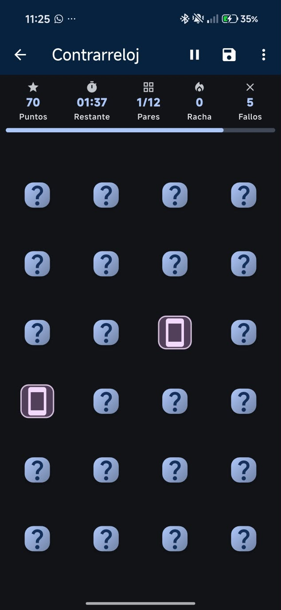
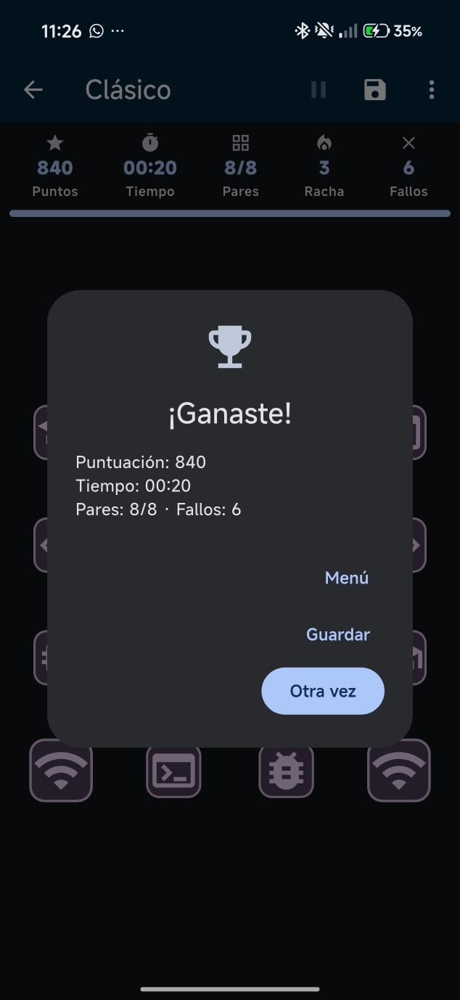
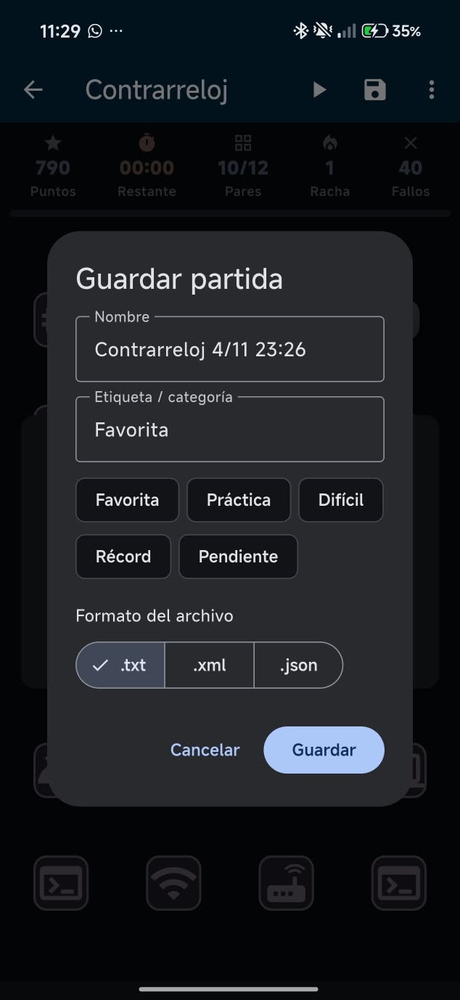
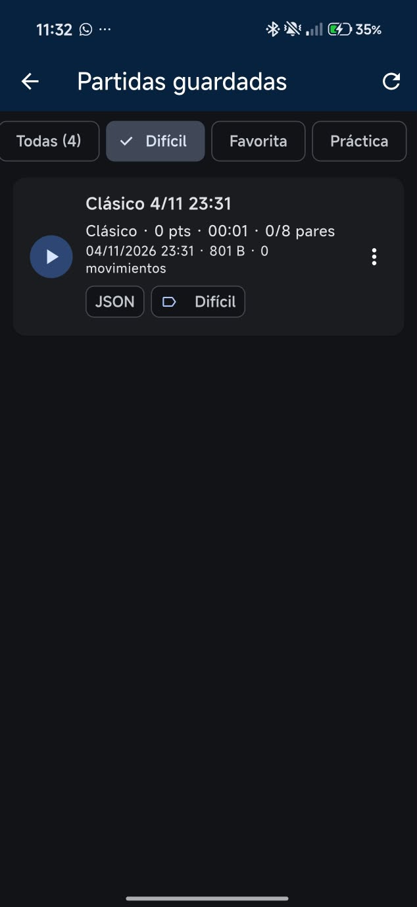
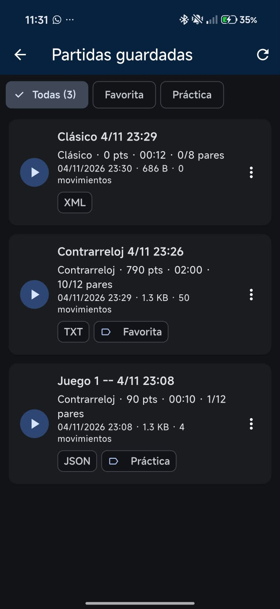
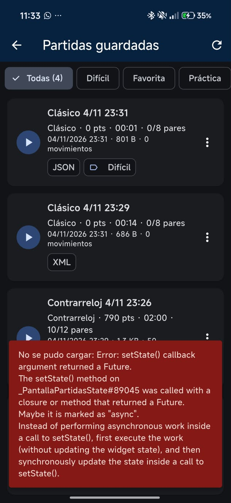
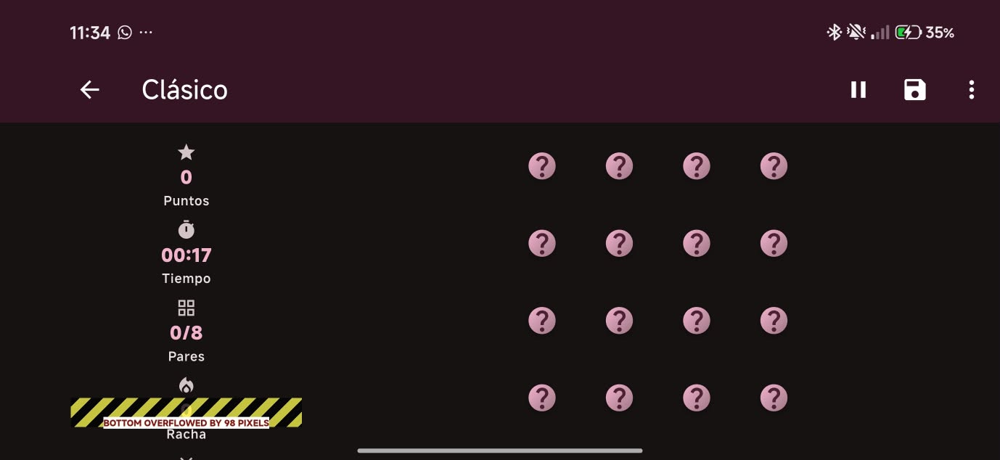
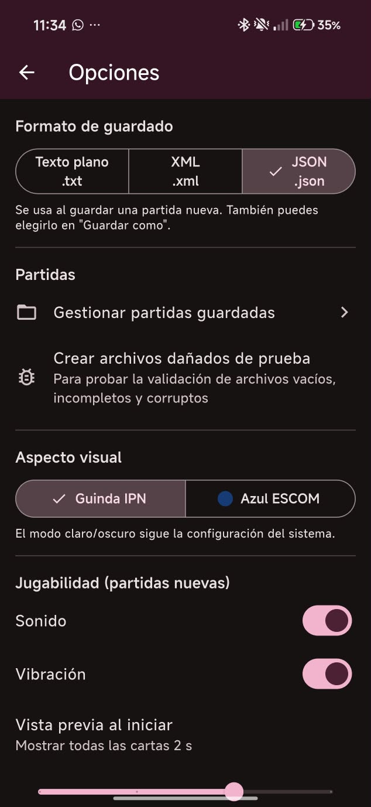

# Memoria ESCOM

**Práctica 4 · Parte 2: Juego con gestión de archivos**
Desarrollo de aplicaciones móviles nativas · ESCOM IPN · Grupo 7CV4

**Memoria ESCOM** Es un juego original de memoria con temática de cómputo. Guarda, carga, visualiza y exporta partidas en **texto plano (.txt), XML (.xml) y JSON (.json)**, y recupera la partida en curso aunque se cierre la app. Funciona **100 % sin conexión**.

> Las versiones del entorno, los pasos completos de instalación y la parte de iOS están en el [README principal](../README.md).

---

## El juego

### Mecánica
Las cartas empiezan boca abajo. En cada turno se voltean dos:
- **Si son iguales**, quedan descubiertas y suman puntos.
- **Si no lo son**, se vuelven a voltear después de 0.75 s y se aplica una penalización.

Se gana al descubrir todas las parejas. Los símbolos son 12 íconos de cómputo: birrete, computadora, memoria, código, terminal, wifi, Android, bug, almacenamiento, nube, router y smartphone.

### Niveles / modos
| Nivel | Tablero | Parejas | Tiempo | Fin de la partida |
|---|---|---|---|---|
| 1 · **Clásico** | 4 × 4 | 8 | Sin límite (cronómetro ascendente) | Al encontrar todas las parejas |
| 2 · **Contrarreloj** | 4 × 6 | 12 | 120 s (cuenta regresiva; se pone roja a partir de 15 s) | Al encontrar todas las parejas o al llegar a 0:00 |

### Puntuación y progreso
| Evento | Puntos |
|---|---|
| Pareja encontrada | **+100 + 20 × racha** (la racha cuenta los aciertos consecutivos) |
| Fallo | **−10** (la puntuación nunca baja de 0) y la racha vuelve a 0 |
| Ganar en Contrarreloj | **Bono de +5 por cada segundo restante** |

El marcador muestra **puntos, tiempo, pares encontrados/total, racha y fallos**, más una barra de progreso.

### Efectos visuales y sonoros
- **Volteo 3D** de las cartas (rotación en el eje Y).
- Las cartas acertadas **crecen un instante** y luego quedan resaltadas con otro color.
- La puntuación cambia con una **animación de escala**.
- **Sonidos** al voltear, acertar, fallar y ganar.
- **Vibración** ligera al voltear y más fuerte al fallar.
- **Vista previa** opcional: al iniciar, se muestran todas las cartas durante 0 a 3 segundos con el aviso "¡Memoriza!".
- **Pausa** con una capa oscura sobre el tablero. Se activa sola si la app pasa a segundo plano.

---

## Gestión de archivos

### Qué se guarda
Cada partida guarda **toda** la información que pide la práctica:

| Requisito | Campos |
|---|---|
| Estado actual del juego | Nivel, tablero (símbolo de cada casilla), cartas descubiertas, terminada/ganada |
| Puntuación | Puntuación, racha, fallos |
| Tiempo transcurrido | Segundos jugados |
| Configuraciones personalizadas | Sonido, vibración, segundos de vista previa, paleta |
| Historial de movimientos | Por cada turno: segundo, casilla A, casilla B, acierto y puntos obtenidos |
| Metadatos | ID, nombre, etiqueta, fecha de creación, fecha de último guardado |

### Los tres formatos
`lib/data/serializacion.dart` convierte el mismo modelo `Partida` a cada formato y de vuelta. Los tres guardan exactamente la misma información, y las pruebas unitarias lo comprueban.

**JSON**: se genera con `jsonEncode` y lleva una firma y una versión.
```json
{
  "formato": "memoria-escom",
  "version": 1,
  "id": "m3k2x9a1b2",
  "nombre": "Contrarreloj 4/11 22:30",
  "etiqueta": "Difícil",
  "nivel": 2,
  "puntuacion": 230, "racha": 1, "fallos": 2, "segundos": 47,
  "terminada": false, "ganada": false,
  "tablero": [3, 7, 1, ...],
  "descubiertas": [true, false, ...],
  "configuracion": { "sonido": true, "vibracion": true, "vistaPrevia": 2, "paleta": "guinda" },
  "historial": [ { "segundo": 12, "a": 0, "b": 9, "acierto": true, "puntos": 100 } ]
}
```

**XML**: se construye con `XmlBuilder` y se lee con `XmlDocument.parse` (paquete `xml`).
```xml
<?xml version="1.0" encoding="UTF-8"?>
<partida formato="memoria-escom" version="1">
  <id>m3k2x9a1b2</id>
  <nombre>Contrarreloj 4/11 22:30</nombre>
  <etiqueta>Difícil</etiqueta>
  <nivel>2</nivel>
  <estado puntuacion="230" racha="1" fallos="2" segundos="47" terminada="false" ganada="false"/>
  <tablero>3,7,1,...</tablero>
  <descubiertas>1,0,...</descubiertas>
  <configuracion><sonido>true</sonido><vibracion>true</vibracion><vistaPrevia>2</vistaPrevia><paleta>guinda</paleta></configuracion>
  <historial total="1"><movimiento segundo="12" a="0" b="9" acierto="true" puntos="100"/></historial>
</partida>
```

**TXT**: un formato propio y legible, con líneas `clave=valor` y una sección `[historial]`.
```
# Partida de Memoria ESCOM
formato=memoria-escom
id=m3k2x9a1b2
nivel=2
puntuacion=230
segundos=47
tablero=3,7,1,...
config.sonido=true
[historial]
12;0;9;true;100
```

### Guardar y cargar
- **Guardar** (💾): sobrescribe el espacio de la partida actual. La primera vez pregunta el nombre, la etiqueta y el formato.
- **Guardar como nueva…**: crea un espacio nuevo (otro ID) con el nombre, la etiqueta y el formato que elija el usuario (`.txt`, `.xml` o `.json`).
- **Formato predeterminado**: se elige en *Opciones* y se recuerda entre sesiones.
- **Ubicación**: almacenamiento **privado** de la app, `getApplicationDocumentsDirectory()/partidas/<id>.<ext>`. Ningún otro programa puede verlo y no requiere permisos.
- **Cargar**: la app detecta el formato por la extensión, valida el contenido y restaura el tablero, el tiempo, la puntuación, el historial y la configuración de esa partida.

### Partidas guardadas
- La lista muestra, de cada partida: nombre, nivel, puntos, tiempo, pares encontrados, fecha de guardado, tamaño del archivo, número de movimientos, **formato** y **etiqueta**. También indica si la partida se ganó o se perdió.
- **Etiquetas o categorías**: libres o sugeridas (*Favorita, Práctica, Difícil, Récord, Pendiente*). Hay **chips de filtro** por etiqueta.
- Acciones del menú de cada partida:

| Acción | Qué hace |
|---|---|
| Cargar | Continúa la partida |
| Ver archivo | Muestra el contenido real del archivo con resaltado de sintaxis, más su formato, tamaño, fecha y ruta |
| Etiqueta | Cambia o quita la categoría |
| Compartir | Hoja para compartir de Android (`share_plus`) |
| Exportar a… | El usuario elige la ubicación con el selector del sistema (`ACTION_CREATE_DOCUMENT`) |
| Eliminar | Pide confirmación |

### Persistencia robusta
- **Escritura atómica**: primero se escribe un archivo `.tmp` y luego se renombra. Si la app se cierra a mitad del guardado, el archivo anterior queda intacto.
- **Autoguardado** en `autoguardado.json`:
  - se escribe cada **10 s**, al pasar la app a segundo plano (`WidgetsBindingObserver`) y al salir de la partida;
  - al abrir la app, el menú muestra **"Continuar"** con el nivel, los puntos y el tiempo;
  - al terminar la partida, el autoguardado se borra.
- **Validación al cargar**. Se rechazan los archivos:
  - vacíos;
  - sin la firma `memoria-escom`;
  - con campos faltantes o de tipo incorrecto;
  - con JSON o XML mal formado;
  - sin la sección `[historial]` (TXT truncado);
  - con un tablero de tamaño incorrecto;
  - con símbolos que no aparecen exactamente dos veces;
  - con parejas descubiertas a medias;
  - con números negativos o movimientos fuera del tablero.
- **Los archivos dañados no afectan a los demás**: aparecen como tarjetas rojas con el motivo, un aviso arriba de la lista cuenta cuántos hay, y se pueden ver o eliminar. Las partidas válidas siguen cargando normalmente.
- *Opciones → Crear archivos dañados de prueba* genera un `.json` vacío, un `.txt` incompleto y un `.xml` corrupto para demostrar esta validación.

---

## Interfaz

- **Menú principal**: *Continuar* (si hay autoguardado), *Nueva partida* (para elegir el nivel), *Partidas guardadas* y *Opciones*.
- **Menú de opciones**, con lo que pide la práctica:
  - **Cambiar el formato de guardado**: TXT, XML o JSON.
  - **Gestionar partidas guardadas**.
  - **Aspecto visual**: Tema Guinda o Azul.
  - **Jugabilidad**: sonido, vibración y segundos de vista previa.
- **Durante la partida**: Pausa, Guardar, *Guardar como nueva…* y *Opciones de la partida* (sonido, vibración y formato).
- **Temas**: **Guinda (IPN, `#6C1D45`)** y **Azul (ESCOM, `#003D79`)**, con **modo claro/oscuro automático** según el sistema.
- **Diseño responsivo**: en vertical, el marcador va arriba y el tablero abajo (4 columnas). En horizontal, el marcador pasa a un panel lateral y el tablero se reacomoda (6 columnas en Contrarreloj). El tamaño de las cartas se calcula para que el tablero siempre quepa completo.

---

## Cómo se cumple cada requisito

| Requisito de la práctica | Dónde |
|---|---|
| Juego original con mecánicas sencillas | `ui/pantalla_juego.dart` → `_tocar()` |
| Estado persistente y recuperable | `data/repositorio.dart` → `autoguardar()`, `leerAutoguardado()`; `ui/menu.dart` |
| Puntuación y progreso | `ui/pantalla_juego.dart` → `_Marcador`, `_terminar()` |
| Al menos 2 niveles o modos | `data/modelo.dart` → `enum Nivel` |
| Efectos visuales y sonoros | `ui/pantalla_juego.dart` → `_Carta`; `core/efectos.dart`; `assets/sonidos/` |
| Guardar en TXT, XML y JSON | `data/serializacion.dart` → `aTxt()`, `aXml()`, `aJson()` |
| Que el usuario elija el formato | `ui/comun.dart` → `dialogoGuardarComo()`; `ui/opciones.dart` |
| Cargar desde los 3 formatos | `data/serializacion.dart` → `desdeTxt()`, `desdeXml()`, `desdeJson()` |
| Estado, puntuación, tiempo, configuración e historial | `data/modelo.dart` → `Partida`, `Configuracion`, `Movimiento` |
| Lista de partidas con metadatos | `ui/partidas.dart` |
| Categorizar o etiquetar | `ui/partidas.dart` → `_cambiarEtiqueta()`, chips de filtro |
| Exportar o compartir | `ui/partidas.dart` (`share_plus`); `platform/exportar_android.dart` + `MainActivity.kt` |
| Temas Guinda y Azul + claro/oscuro | `core/tema.dart`, `main.dart` |
| Menú de opciones (formato, partidas, visual y jugabilidad) | `ui/opciones.dart` |
| Ver el contenido de los archivos | `ui/ver_archivo.dart` + `ui/resaltado.dart` |
| Interfaz responsiva | `ui/pantalla_juego.dart` (`LayoutBuilder`), `ui/menu.dart` |
| Guardar en el almacenamiento privado | `data/repositorio.dart` → `inicializar()` |
| Recuperar la partida tras cerrar la app | `WidgetsBindingObserver` en `ui/pantalla_juego.dart` |
| Validar archivos vacíos, incompletos o corruptos | `Serializador.deserializar()`, `Partida.validar()`, `Repositorio.listar()` |

---

## Arquitectura

```
lib/
├── main.dart                 Inicializa ajustes y repositorio; MaterialApp con temas
├── core/
│   ├── tema.dart             Paletas Guinda y Azul, ThemeData claro y oscuro
│   ├── efectos.dart          Sonidos (audioplayers) y vibración (HapticFeedback)
│   └── formato.dart          Tiempo mm:ss, fechas, tamaños y mensajes de error
├── data/
│   ├── modelo.dart           Nivel, Partida, Configuracion, Movimiento y validación
│   ├── serializacion.dart    FormatoGuardado y Serializador TXT / XML / JSON
│   ├── repositorio.dart      Guardar, cargar, listar, etiquetar, eliminar y autoguardado
│   └── ajustes.dart          Preferencias globales (shared_preferences)
├── platform/
│   └── exportar_android.dart MethodChannel "mx.ipn.escom/archivos"
└── ui/
    ├── menu.dart             Menú principal
    ├── pantalla_juego.dart   Tablero, cartas, marcador, pausa y guardado
    ├── partidas.dart         Lista, filtros y acciones de partidas
    ├── ver_archivo.dart      Contenido del archivo con resaltado
    ├── opciones.dart         Menú de opciones
    ├── comun.dart            Diálogo "Guardar como" y mensajes
    └── resaltado.dart        Resaltado de sintaxis JSON/XML

android/app/src/main/kotlin/mx/ipn/escom/juego/MainActivity.kt
assets/sonidos/              voltear.wav, acierto.wav, fallo.wav, victoria.wav (generados para el proyecto)
test/widget_test.dart        Pruebas de serialización
```

### Código específico de Android
`MainActivity.kt` implementa el método `exportar` del canal `mx.ipn.escom/archivos`:
1. Abre `Intent.ACTION_CREATE_DOCUMENT` para que el usuario elija el destino y el nombre.
2. Copia el archivo de la partida con `ContentResolver.openOutputStream()` en un hilo secundario.
3. Si el usuario cancela, devuelve `null` y la app muestra "Exportación cancelada".

El manifiesto **no** declara permisos de almacenamiento: las partidas viven en el almacenamiento privado y la exportación pasa por el selector del sistema (Storage Access Framework).

---

## Dependencias

| Paquete | Uso |
|---|---|
| `path_provider` | Carpeta privada de documentos |
| `shared_preferences` | Formato predeterminado, tema, sonido, vibración y vista previa |
| `xml` | Serialización y lectura de partidas en XML |
| `audioplayers` | Efectos de sonido |
| `share_plus` | Compartir partidas |
| `path` | Manejo de rutas |

Las versiones exactas están en el [README principal](../README.md#dependencias).

---

## Ejecutar

```bash
cd juego
flutter pub get
flutter run
```

Pruebas unitarias:
```bash
flutter test
```

| Prueba | Verifica |
|---|---|
| Ida y vuelta en Texto plano / XML / JSON | Guardar y volver a cargar produce exactamente la misma partida |
| Archivo vacío (×3 formatos) | Se rechaza con `FormatException` |
| Archivo truncado (×3 formatos) | Se rechaza con `FormatException` |
| Tablero manipulado | Se rechaza porque las parejas no son válidas |

---

## Uso rápido

1. **Nueva partida** → elige *Clásico* o *Contrarreloj* → memoriza → voltea las cartas.
2. 💾 **Guardar** → escribe el nombre y la etiqueta, y elige `.txt`, `.xml` o `.json`.
3. ⋮ → **Guardar como nueva…** para guardar la misma partida en otro formato.
4. Sal de la app a mitad de una partida, ciérrala y vuelve a abrirla: aparece **Continuar**.
5. **Partidas guardadas** → filtra por etiqueta → ⋮ → *Ver archivo*, *Exportar a…*, *Compartir*.
6. **Opciones** → *Crear archivos dañados de prueba* → revisa *Partidas guardadas*.

---

## Pruebas realizadas (Android)

**Dispositivos:**
| ID | Dispositivo | Tipo | Versión |
|---|---|---|---|
| D1 | Xiaomi 2511FPC34G | Físico | Android 16 (API 36) · HyperOS ⟨x⟩ |
| D2 | Pixel ⟨modelo⟩ | Emulador | Android 7.0 (API 24) |

**Simbología:** ✅ pasó · ❌ falló · ⚠️ pasó con observaciones. La evidencia está en `docs/capturas/android/`.

| ID | SO / Versión | Dispositivo | Caso | Pasos | Resultado esperado | Resultado obtenido | Evidencia |
|---|---|---|---|---|---|---|---|
| J01 | Android 16 / 7.0 | D1, D2 | Funcionamiento offline | Modo avión → jugar, guardar y cargar | Todo funciona sin conexión | | [J01](../docs/capturas/android/J01.jpeg) |
| J02 | Android 16 | D1 | Nivel 1 Clásico | Nueva partida → Clásico → completar el tablero | Diálogo "¡Ganaste!" con puntuación, tiempo y fallos | | [J02](../docs/capturas/android/J02.jpeg) |
| J03 | Android 16 | D1 | Nivel 2 Contrarreloj | Nueva partida → Contrarreloj → dejar que se acabe el tiempo | Al llegar a 0:00 aparece "Se acabó el tiempo" | | [J03](../docs/capturas/android/J03.jpeg) |
| J04 | Android 16 | D1 | Puntuación y racha | Acertar 2 seguidas y fallar 1 | +100, +120, −10; la racha vuelve a 0 | | [J04](../docs/capturas/android/J04.jpeg) |
| J05 | Android 16 | D1 | Efectos visuales y sonoros | Voltear, acertar y fallar | Animación de volteo, escala al acertar, sonidos y vibración | | [J05](../docs/capturas/android/J05.jpeg) |
| J06 | Android 16 | D1 | Guardar en TXT | ⋮ → Guardar como nueva → `.txt` | Aparece el archivo `.txt` en Partidas guardadas | | [J06](../docs/capturas/android/J06.jpeg) |
| J07 | Android 16 | D1 | Guardar en XML | ⋮ → Guardar como nueva → `.xml` | Aparece el archivo `.xml` | | [J07](../docs/capturas/android/J07.jpeg) |
| J08 | Android 16 | D1 | Guardar en JSON | ⋮ → Guardar como nueva → `.json` | Aparece el archivo `.json` | | [J08](../docs/capturas/android/J08.jpeg) |
| J09 | Android 16 | D1 | Cargar cada formato | Cargar las partidas de J06, J07 y J08 | Mismo tablero, puntos, tiempo e historial | | [J09](../docs/capturas/android/J09.jpeg) |
| J10 | Android 16 | D1 | Ver contenido | Partidas → ⋮ → Ver archivo (en cada formato) | Contenido con resaltado, formato, tamaño y ruta | | [J10](../docs/capturas/android/J10.jpeg) |
| J11 | Android 16 | D1 | Etiquetas y filtro | ⋮ → Etiqueta → "Difícil" → tocar el chip "Difícil" | Solo se muestran las partidas con esa etiqueta | | [J11](../docs/capturas/android/J11.jpeg) |
| J12 | Android 16 | D1 | Exportar | ⋮ → Exportar a… → elegir Documentos | El archivo aparece en la carpeta elegida; si se cancela, sale "Exportación cancelada" | | [J12](../docs/capturas/android/J12.jpeg) |
| J13 | Android 16 | D1 | Compartir | ⋮ → Compartir | Se abre la hoja para compartir de Android | | [J13](../docs/capturas/android/J13.jpeg) |
| J14 | Android 16 | D1 | Archivos dañados | Opciones → Crear archivos dañados → Partidas guardadas | 3 tarjetas rojas con el motivo del error; las demás partidas cargan bien | | [J14](../docs/capturas/android/J14.jpeg) |
| J15 | Android 16 | D1 | Recuperación tras cerrar | Jugar a medias → cerrar la app a la fuerza desde recientes → reabrir | Botón "Continuar" con el mismo progreso | | [J15](../docs/capturas/android/J15.jpeg) |
| J16 | Android 16 | D1 | Formato predeterminado | Opciones → XML → nueva partida → 💾 Guardar | Se guarda como `.xml` | | [J16](../docs/capturas/android/J16.jpeg) |
| J17 | Android 16 / 7.0 | D1, D2 | Temas y modo oscuro | Opciones → Guinda / Azul; cambiar el modo del sistema | Las 4 combinaciones se ven correctamente | | [J17](../docs/capturas/android/J17.jpeg) |
| J18 | Android 16 | D1 | Interfaz responsiva | Girar el teléfono durante la partida | El tablero se reacomoda y el marcador pasa al lado | | [J18](../docs/capturas/android/J18.jpeg) |
| J19 | Android 7.0 | D2 | Compatibilidad API 24 | Repetir J02, J06 y J09 en API 24 | Funciona igual | | [J19](../docs/capturas/android/J19.png) |
| J20 | — | PC | Pruebas unitarias | `cd juego && flutter test` | Las 10 pruebas pasan | | captura de la terminal |

**Resumen:** ⟨n⟩ de 20 casos pasaron · ⟨n⟩ con observaciones · ⟨n⟩ fallaron.

## Capturas

| Menú | Partida | Guardar como | Partidas guardadas |
|---|---|---|---|
|  |  |  |  |

| Ver archivo (XML) | Archivos dañados | Horizontal | Tema Azul oscuro |
|---|---|---|---|
|  |  |  |  |


## Limitaciones conocidas

- Si se sale de una partida sin presionar Guardar, el progreso queda en el autoguardado (botón "Continuar"), pero no se escribe en el archivo de esa partida.
- "Guardar" sobre una partida en otro formato reemplaza el archivo anterior de ese mismo espacio. Para tener la misma partida en varios formatos se usa "Guardar como nueva…".
- Los sonidos dependen del volumen multimedia del dispositivo. En algunos emuladores sin audio no se escuchan, pero el juego sigue funcionando.